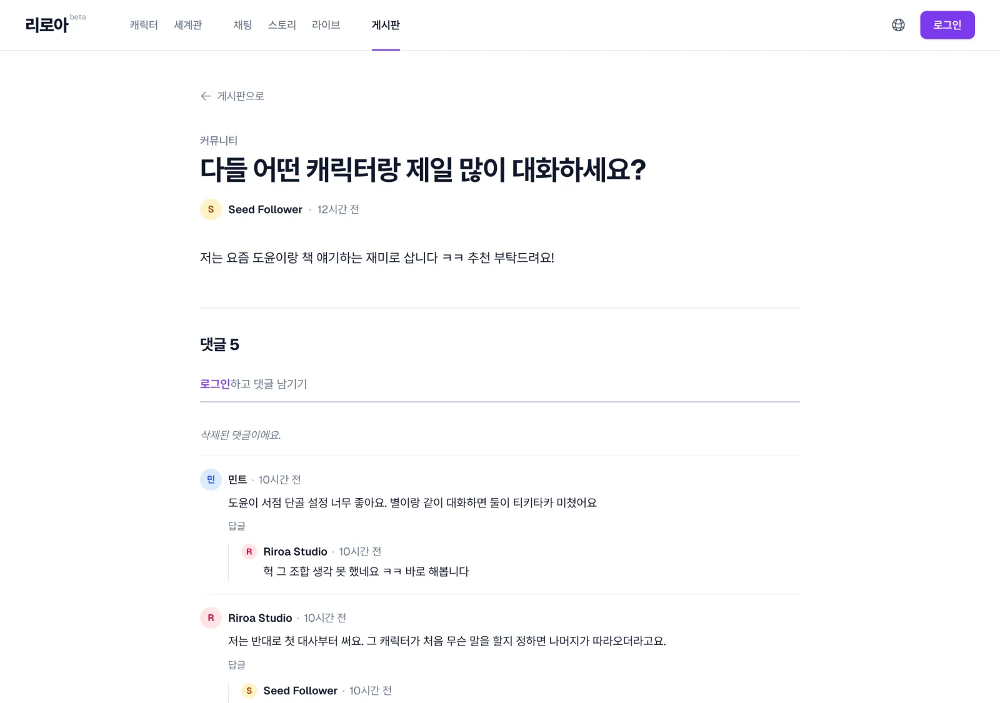
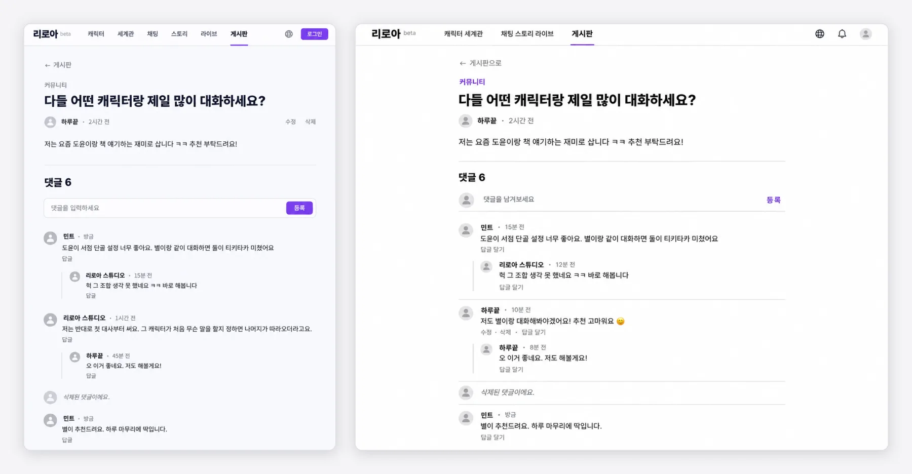
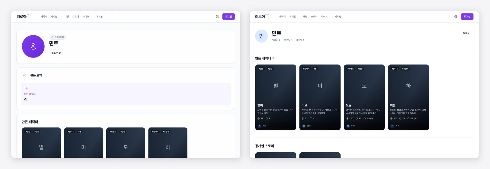
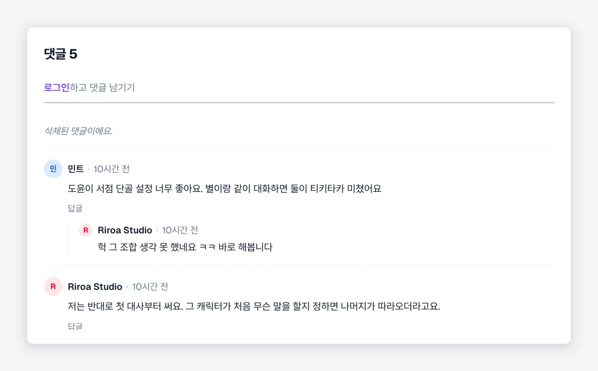

[Riroa](/projects/riroa/) is a web app where you make characters and worlds, then chat and write stories with them. Features kept landing, and the screens looked more and more like an AI had made them: a bordered box around every section, an icon on every heading, chips and badges everywhere. So over three days from November 16 I redid them page by page: the character and world detail pages, the top navigation, the board and comments, the forms, then the rest.

*The board post page after the redesign. Whitespace and thin rules separate the sections instead of boxes.*

Claude Code wrote the code. I picked mockups and set the direction. The steps varied a little from page to page, but the basic order was this: Codex draws several mockups, the shared components are extended to match them first, and then separate agents check rendering, taste and usability. The skills and agents that run this order, the harness, are public in my [dotfiles](https://github.com/zeikar/dotfiles/tree/main/claude/.claude).

## Codex draws the mockups, many of them

Mockups come from the [`codex-image`](https://github.com/zeikar/dotfiles/blob/main/claude/.claude/skills/codex-image/SKILL.md) skill, a wrapper that calls the Codex CLI's image generation tool through `codex exec`. Each call is its own session, so several run in the background at once. One takes a minute or two, and I drew 45 in all.

Given no direction, the model falls back to a default design much like the current pages. When I redrew the detail page from a bare prompt, it came back with icon-prefixed headings, chips, boxes inside boxes and a sunset plum painted on as a brand colour: everything I was trying to remove. So the prompt spends as many words on what not to draw as on what to draw.

> Must NOT appear: follower counts, @handles, verified badges, price tags, AI sparkle ✨ icons, "AI-generated" labels, chatbot bubbles, glowing gradients, glassmorphism, neon, purple-to-pink gradients, 3D blobs, emoji decorations, dashboard-style KPI tiles with big numbers, a card around every single section.

Things the data doesn't have go on the same list. The model respects what the list forbids and freely invents what it doesn't.

### With or without a screenshot

Attaching a screenshot of the current screen with `-i` changes the result a lot. For the board I asked for plenty of mockups both with and without the screenshot, cost no object. From the same list of screens came 8 with the screenshot attached and 6 with only a written direction.

*The same request with a different reference. Left: screenshot attached. Right: written direction only.*

- With the screenshot, the navigation, fonts and widths are almost the app's own, but old traces come along too, such as the "게시일:" (posted on) label I meant to drop.
- Without it, the structure is bolder, and the cleanest post page came from this side. It also invents features: a reply button on a nested reply, filled stars on a character nobody had rated.

I didn't have to pick one. The board list and the mobile screens came from screenshot mockups, the post page and comments from text-only ones.

### Mockups are references

The detail pages started from a few directions. When I pointed out that character images are portrait and world images are landscape, the two pages got separate skeletons: the character page is a magazine spread with the portrait filling the left side top to bottom, and the world page opens with its landscape cover across the full page width. Claude's case for it was that the skeletons differ but still read as one app. Before that I had asked for more mockups that ignored consistency, ended up with too many to choose from, and told Claude to go with its recommendation. The one thing I insisted on was a ">" on the Start button, so it reads as something that opens.

*The character detail page. Left to right: before, mockup, build. The person in the mockup has a different face altogether.*

Only the skeleton came from the mockup. The person in it has a different face from the real character, and the profile values are made up. The world mockup cropped the 5:4 cover top and bottom into a thin strip. The implementing agent gets the mockup as a "loose reference" along with a list of what to ignore.

## Extend the shared components first

Build each page from its own mockup and you get one near-copy of a component per page. That had already happened: the navigation had its own `UserAvatar` that drew initials for users without a photo, separate from the shared `AvatarFrame`. While merging them I asked Claude whether the docs say to reuse shared modules. It said the guidance was scattered across individual components, and nothing said "if a shared component almost fits, add an option instead of making a new one". That missing rule is how `UserAvatar` happened. So `AGENTS.md`, which every session reads, got one line.

> Reuse before you build: look for a component that already does the job … If one almost fits, extend it with an optional prop instead of building a parallel one, and keep its default output unchanged so existing callers don't move.

Every option added in this redesign keeps the old default.

- `Input` got `appearance="underline"`: the underlined title field on the board's write page.
- `TabNav` got `look="underline"`: tabs that borrow the navigation's underlined links, used on the account pages and the browse sort bar. The pill stays the default.
- `AvatarFrame` got `name` and `tintSeed`: the initial fallback and a per-user tint.

The detail pages' section style (`DetailSection`) was later reused as is by the board and the profile. `SpotlightCard`, `PresetPillButton` and the stat-tile components, unused after the redesign, were deleted.

The order paid off most on the last day. Four groups of pages went to four teammate agents at once: profile, settings, the character and world browse pages, and collections plus notifications. The main session built and committed the shared-component options they needed first, and the briefs said to read `AGENTS.md` and the component catalogue before anything else. The four worked in one checkout, each on its own files, and asked before touching anything outside their scope. The browse-pages agent asked whether it could add an option to the shared `CreateCharacterButton`, and got a yes on condition that a test pinned the default look.

*The user profile, redone by a teammate agent. Left: before. Right: after.*

Midway I asked whether the site still looked consistent as a whole. Claude captured eight pages and compared them. The redesigned pages matched each other, but one new mismatch showed up: users without a photo were drawn three ways, a grey initial in the navigation, a tinted initial in comments and a large violet circle on the profile. One rule fixed that at the end.

## Three reviews, three questions

After the build come three separate reviews. All three look at the same screens and ask different things.

| Review | Asks | How | Verdict |
|---|---|---|---|
| [`visual-review`](https://github.com/zeikar/dotfiles/blob/main/claude/.claude/skills/visual-review/SKILL.md) | Is it rendered right? | Screenshots at desktop, phone and short-phone sizes with Playwright | List of issues |
| [`aesthetic-critic`](https://github.com/zeikar/dotfiles/blob/main/claude/.claude/agents/aesthetic-critic.md) | Does it look well made? | Reads the saved screenshots only | SHIP / POLISH / REWORK |
| [`usability-critic`](https://github.com/zeikar/dotfiles/blob/main/claude/.claude/agents/usability-critic.md) | Can a person use it? | Drives the browser and finishes real tasks | SHIP / FRICTION / BLOCKED |

Even one selected-tab marker splits three ways. visual-review checks that it's drawn and not clipped, aesthetic-critic whether its weight and colour fit the hierarchy, usability-critic whether someone looking at it knows where they are. Without that split, the same problem gets fixed twice or by nobody.

aesthetic-critic never touches the browser, because two agents sharing one browser take the screen from each other. It reads only what visual-review captured, and anything not captured, such as dark mode or a hover state, stays `NOT ASSESSED`. One unassessed item rules out SHIP.

The verdicts were stingy. The navigation got POLISH 7/10 on the first pass, because the dropdowns, the avatar and the open states still looked like a SaaS template. After the fixes the same agent gave it 8.5/10, still not SHIP, because two captures were missing.

### All three pointed at the same spot

The board and comments were the first round where all three reviews ran. visual-review found one Major, aesthetic-critic gave POLISH 7/10, usability-critic said FRICTION. Their findings converged on the comment bar pinned to the bottom of the phone screen. visual-review: its field showed no focus indicator. aesthetic-critic: the field's underline was the same line as the dividers between comments, so it didn't read as a field. usability-critic: a comment sent from the bar landed 1,065px below the screen, out of sight, and two near-identical fields were on screen at once.

Claude's merged list of the three reviews put the bar first too, marked "flagged by all three". Each problem was small, but when three reviews hit one spot for different reasons, the thing to fix is the bar itself. It went, and a single comment field now sits above the thread.

What aesthetic-critic called most template-like was the grey person icon repeated for every user without a photo ("the generic tell"). I suggested that if grey was the problem, we could derive a colour from the user ID. Now each user gets their initial on a fixed pale tint, and the icon is left only for guests and deleted users.

{: width="600" style="margin-inline: auto"}

*The comment thread after the reviews: initials with a per-user tint, and replies one level deep.*

Guests are all named "게스트 xxxx" (Guest xxxx), so every guest initial was "게". The navigation review suggested taking the initial from the ID instead. I thought the grey person icon suited a guest better and went with that.

## The harness still gets skipped

When the board was built, I asked whether the code review and visual review were done. Claude said the visual review was half done: it had taken a few screenshots itself, but hadn't run the visual-review sub-agent or either critic. The three reviews above came after that question. For the navigation I had asked for a visual review of the screenshots already taken, and the only thing that ran was aesthetic-critic.

The first day went the other way. Claude put the detail pages into a large pipeline of plan writing, plan review and an implementation loop. When I asked whether a simple UI change needed a plan, it stopped the plan and went straight to building. Since then a UI redesign skips the plan loop and gets one code review and one visual-review pass, critics included.

The harness gets fixed as it's used. A commit from early November, when I redid Riroa's Live screen, folded what I learned into the skills ([`900aa01`](https://github.com/zeikar/dotfiles/commit/900aa01)). Two of those lessons held up again this time.

- A mockup gets the current screen and every real state: out of credits, empty, dark mode, mobile. Draw only the ideal screen and those states get bolted on during the build, and the result looks generated again.
- The critics run on the first review pass. Run later, aesthetic-critic once returned 16 findings in a lump that would have steered the earlier fixes.

Asking whether the reviews actually ran is still my job.
