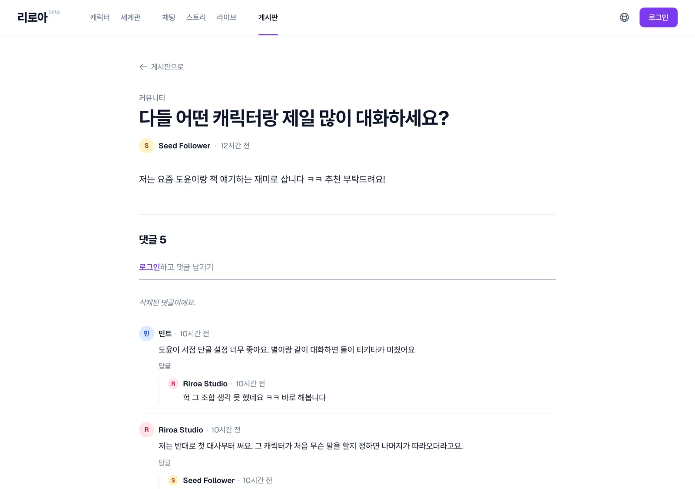
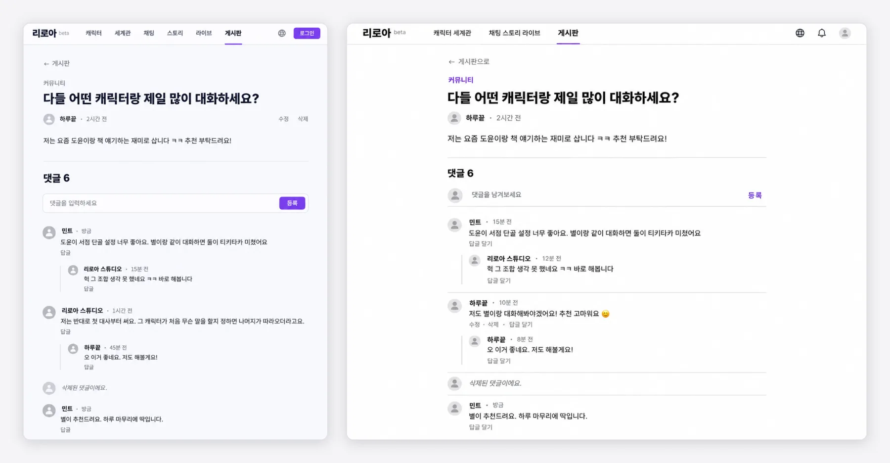
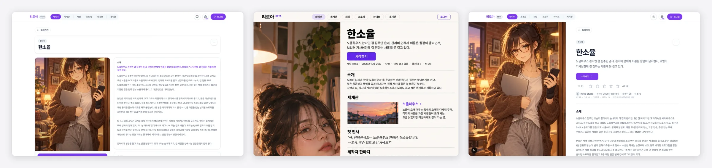
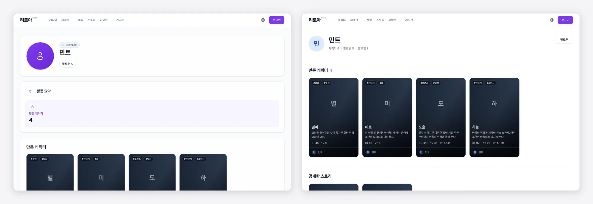
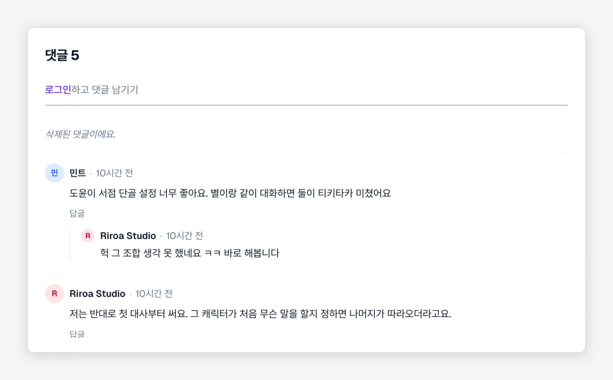

[Riroa](/projects/riroa/)는 캐릭터와 세계관을 만들고 그 캐릭터들과 채팅하고 이야기를 쓰는 웹앱이다. 기능은 꾸준히 늘었는데 화면은 갈수록 AI가 만든 것처럼 보였다. 섹션마다 테두리 박스가 있고, 제목마다 아이콘이 붙고, 칩과 배지가 곳곳에 있었다. 그래서 11월 16일부터 사흘 동안 캐릭터와 세계관 상세 페이지, 상단 내비게이션, 게시판과 댓글, 폼, 나머지 페이지 순으로 다시 짰다.

*개편 뒤의 게시판 글 보기. 박스 대신 여백과 가는 구분선으로 섹션을 나눈다.*

코드는 Claude Code가 썼고, 나는 시안을 고르고 방향을 정했다. 페이지마다 조금씩 달랐지만 기본 순서는 이랬다. Codex로 시안을 여러 장 뽑고, 거기에 맞춰 공통 컴포넌트를 먼저 넓힌 다음, 렌더링과 미감과 사용성을 서로 다른 에이전트가 본다. 이 순서를 굴리는 스킬과 에이전트, 곧 하네스는 [dotfiles](https://github.com/zeikar/dotfiles/tree/main/claude/.claude)에 공개돼 있다.

## 시안은 Codex가 여러 장 그린다

시안은 [`codex-image`](https://github.com/zeikar/dotfiles/blob/main/claude/.claude/skills/codex-image/SKILL.md) 스킬로 뽑는다. Codex CLI의 이미지 생성 도구를 `codex exec`로 부르는 래퍼고, 부를 때마다 독립된 세션이라 백그라운드로 여러 장을 동시에 돌릴 수 있다. 한 장에 1~2분이 걸리고, 이번 개편에서 뽑은 시안은 모두 45장이다.

방향을 아무것도 주지 않으면 모델은 지금 페이지와 비슷한 기본 디자인으로 돌아간다. 상세 페이지 시안을 프롬프트만으로 다시 뽑아 봤더니 아이콘을 붙인 제목, 칩, 박스 안의 박스, 브랜드 색처럼 칠한 노을빛 자주색이 그대로 나왔다. 다 걷어 내려던 것이다. 그래서 프롬프트에는 그리지 말 것도 그릴 것만큼 길게 적는다.

> Must NOT appear: follower counts, @handles, verified badges, price tags, AI sparkle ✨ icons, "AI-generated" labels, chatbot bubbles, glowing gradients, glassmorphism, neon, purple-to-pink gradients, 3D blobs, emoji decorations, dashboard-style KPI tiles with big numbers, a card around every single section.

데이터에 없는 것도 같은 목록에 넣는다. 금지 목록에 적은 건 잘 지키고, 안 적은 건 마음대로 지어낸다.

### 캡처를 붙이느냐 마느냐

`-i`로 현재 화면 스크린샷을 붙이면 결과가 꽤 달라진다. 게시판 차례에는 "캡처 넣는거 안넣은거 해서 시안 많이 뽑아줘 ㅋㅋ codex image는 비용걱정말고 쓰면돼"라고 했고, 같은 화면 목록을 놓고 캡처를 붙인 시안 8장과 글로 방향만 준 시안 6장이 나왔다.

*같은 요청에 참고 이미지만 다르게 줬다. 왼쪽은 캡처를 붙였고, 오른쪽은 글로만 방향을 줬다.*

- 캡처를 붙인 쪽은 내비게이션, 글꼴, 폭이 지금 앱과 거의 같다. 다만 지우려던 "게시일:" 라벨 같은 예전 흔적까지 따라왔다.
- 캡처 없이 뽑은 쪽은 구조가 더 과감하고, 글 보기는 이쪽 시안이 가장 깔끔했다. 대신 없는 기능을 지어낸다. 대댓글에 또 답글 버튼이 달려 있었고, 평가가 없는 캐릭터에 별이 채워져 있었다.

하나만 고를 필요는 없었다. 게시판 목록과 모바일은 캡처를 붙인 시안에서, 글 보기와 댓글은 캡처 없는 시안에서 가져왔다.

### 시안은 참고만 한다

상세 페이지는 몇 가지 방향으로 시작했다. 내가 "캐릭터는 세로 이미지이고 세계관은 가로 이미지"라고 짚자 두 페이지의 골격을 따로 그리는 쪽으로 넘어갔다. 캐릭터는 세로 초상화가 왼쪽 높이를 다 채우는 잡지 펼침면, 세계관은 가로 표지를 페이지 폭 전체에 까는 커버로 시작한다. 골격이 달라도 한 앱처럼 보인다는 게 Claude의 추천 이유였다. 그 전에 통일감은 무시하고 더 뽑아 보라고 했다가 시안이 너무 많아져서, 결국 "와 못고르겠는데 ㅋㅋㅋ 일단 너의 추천대로 해줘"라고 했다. 시작하기 버튼에 열린다는 느낌의 ">"를 꼭 넣어 달라는 것만 덧붙였다.

*캐릭터 상세 페이지. 왼쪽부터 개편 전, 시안, 구현. 시안 속 인물은 아예 다른 얼굴이다.*

시안에서 가져온 건 골격뿐이다. 시안 속 인물은 실제 캐릭터와 얼굴이 다르고, 프로필 값도 지어낸 것이다. 세계관 시안은 5:4 표지를 위아래로 잘라 가늘게 만들어 놓았다. 구현을 맡은 쪽에는 시안을 "loose reference"라고 넘기고, 무시할 것을 목록으로 같이 준다.

## 공통 컴포넌트를 먼저 넓힌다

페이지마다 시안을 따로 구현하면 비슷한 컴포넌트가 페이지 수만큼 생긴다. 실제로 그랬다. 사진 없는 사용자의 이니셜을 그리는 `UserAvatar`가 공통 `AvatarFrame`과 별개로 내비게이션 전용으로 만들어져 있었다. 둘을 합치면서 Claude에게 문서에 공통 모듈 재사용 규칙이 있느냐고 물었더니, 컴포넌트별로 흩어져 있을 뿐 "거의 맞는 공통 컴포넌트가 있으면 새로 만들지 말고 옵션을 더하라"는 규칙은 없다고 했다. `UserAvatar`도 그 규칙이 없어서 생긴 것이다. 그래서 모든 세션이 읽는 `AGENTS.md`에 한 줄을 넣었다.

> Reuse before you build: look for a component that already does the job … If one almost fits, extend it with an optional prop instead of building a parallel one, and keep its default output unchanged so existing callers don't move.

이번에 더한 옵션도 모두 기본값은 예전 그대로다.

- `Input`에 `appearance="underline"`: 게시판 글쓰기의 밑줄 제목 입력란
- `TabNav`에 `look="underline"`: 내비게이션의 밑줄 링크를 옮겨 온 탭. 계정 페이지와 목록 정렬 탭이 쓰고, 알약 모양이 기본으로 남는다.
- `AvatarFrame`에 `name`과 `tintSeed`: 이니셜 대체와 사용자별 색

상세 페이지의 섹션 스타일(`DetailSection`)은 나중에 게시판과 프로필이 그대로 가져다 썼다. 개편 뒤 아무도 안 쓰게 된 `SpotlightCard`, `PresetPillButton`, 통계 타일 컴포넌트는 지웠다.

이 순서로 가장 덕을 본 건 마지막 날이다. 프로필, 설정, 캐릭터와 세계관 목록, 컬렉션과 알림, 네 묶음을 팀원 에이전트 넷에게 동시에 맡겼다. 메인 세션이 필요한 공통 컴포넌트 옵션을 먼저 만들어 커밋하고, 브리핑에는 `AGENTS.md`와 컴포넌트 카탈로그를 먼저 읽으라고 적었다. 네 에이전트는 같은 체크아웃에서 각자 맡은 파일만 고쳤고, 범위 밖 파일을 건드려야 할 때는 먼저 물어 왔다. 캐릭터와 세계관 목록 담당은 공통 `CreateCharacterButton`에 옵션을 하나 더해도 되냐고 물었고, 기본 모양을 테스트로 고정하는 조건으로 넣었다.

*팀원 에이전트가 맡은 유저 프로필. 왼쪽이 개편 전, 오른쪽이 개편 뒤.*

중간에 사이트 전체의 통일감이 괜찮냐고 물었을 때 Claude는 페이지 8개를 캡처해서 비교했다. 개편한 페이지끼리는 맞았지만 새 불일치가 하나 보였다. 사진 없는 사용자의 아바타가 내비게이션에서는 회색 이니셜, 댓글에서는 색 이니셜, 프로필에서는 커다란 보라색 원, 세 가지로 그려지고 있었다. 이건 마지막에 규칙 하나로 정리했다.

## 리뷰는 셋, 질문도 셋

구현이 끝나면 리뷰를 세 번 따로 한다. 셋 다 같은 화면을 보지만 묻는 게 다르다.

| 리뷰 | 묻는 것 | 방식 | 판정 |
|---|---|---|---|
| [`visual-review`](https://github.com/zeikar/dotfiles/blob/main/claude/.claude/skills/visual-review/SKILL.md) | 제대로 그려졌나 | Playwright로 데스크톱, 모바일, 짧은 폰 크기 화면을 찍는다 | 문제 목록 |
| [`aesthetic-critic`](https://github.com/zeikar/dotfiles/blob/main/claude/.claude/agents/aesthetic-critic.md) | 잘 만든 화면인가 | 저장된 스크린샷만 읽는다 | SHIP / POLISH / REWORK |
| [`usability-critic`](https://github.com/zeikar/dotfiles/blob/main/claude/.claude/agents/usability-critic.md) | 사람이 쓸 수 있나 | 브라우저를 직접 조작해 작업을 끝까지 해 본다 | SHIP / FRICTION / BLOCKED |

선택된 탭 표시 하나를 놓고도 질문이 갈린다. visual-review는 그 표시가 그려졌고 잘리지 않았는지를, aesthetic-critic은 그 굵기와 색이 위계에 맞는지를, usability-critic은 사용자가 그걸 보고 지금 어디 있는지 아는지를 본다. 질문을 나눠 두지 않으면 같은 문제를 두 번 고치거나 아무도 안 고친다.

aesthetic-critic은 브라우저를 만지지 않는다. 브라우저 하나를 같이 쓰면 서로 화면을 빼앗기 때문이다. 그래서 visual-review가 찍어 둔 스크린샷만 보고, 찍히지 않은 다크 모드나 호버 상태는 `NOT ASSESSED`로 남긴다. 못 본 항목이 하나라도 있으면 SHIP을 줄 수 없다.

판정은 꽤 박했다. 내비게이션은 첫 회에 POLISH 7/10이었다. 드롭다운과 아바타, 열린 상태 표시가 아직 SaaS 템플릿처럼 보인다는 이유였다. 고친 뒤 같은 에이전트에게 다시 보내니 8.5/10이 나왔지만, 빠진 캡처 두 장 때문에 SHIP은 아니었다.

### 셋이 같은 곳을 짚었다

게시판과 댓글 차례에 처음으로 세 리뷰를 모두 돌렸다. 판정은 visual-review가 Major 하나, aesthetic-critic이 POLISH 7/10, usability-critic이 FRICTION이었다. 그런데 셋의 지적이 모바일 하단에 고정해 둔 댓글 입력 바 한 곳에 몰렸다. visual-review는 바의 입력란에 포커스 표시가 없다고 했고, aesthetic-critic은 입력란의 밑줄이 댓글 사이 구분선과 같은 선이라 구별되지 않는다고 했다. usability-critic은 폰에서 하단 바로 댓글을 보내면 새 댓글이 화면 아래 1,065px에 달려서 안 보이고, 본문 아래 입력란과 비슷한 입력란이 화면에 두 개 떠 있다고 했다.

Claude가 세 리뷰를 합친 목록도 이 바를 1순위에 올리고 "세 평가 모두 지적"이라고 달았다. 하나씩은 작은 문제지만, 셋이 다른 이유로 한곳을 짚었다면 고칠 건 바 자체다. 하단 바를 없애고 댓글 입력란을 목록 위에 하나만 두었다.

aesthetic-critic이 AI 템플릿 같다고 가장 크게 지적한 건 사진 없는 사용자마다 똑같이 반복되는 회색 사람 아이콘이었다("the generic tell"). 회색이 문제라면 아이디로 색을 뽑자고 내가 제안했고, 그래서 사용자마다 고정된 옅은 색 위에 이니셜을 그린다. 아이콘은 게스트와 탈퇴한 사용자에게만 남았다.

{: width="600" style="margin-inline: auto"}

*리뷰 뒤의 댓글 목록. 사용자마다 색이 정해진 이니셜과, 한 단계짜리 답글.*

게스트는 이름이 전부 "게스트 xxxx"라서 이니셜이 모두 "게"였다. 내비게이션 리뷰는 아이디에서 이니셜을 따자고 했지만, 게스트에게는 회색 사람 아이콘이 더 맞다고 보고 그쪽으로 갔다.

## 하네스가 있어도 빼먹는다

게시판 구현이 끝났을 때 코드 리뷰랑 비주얼 리뷰는 다 했냐고 물었더니, Claude는 비주얼 리뷰를 절반만 했다고 답했다. 스크린샷 몇 장을 직접 찍어 봤을 뿐, visual-review 서브에이전트와 두 크리틱은 돌리지 않은 상태였다. 위의 세 리뷰 결과는 그 질문 뒤에 나왔다. 내비게이션 때는 찍어 둔 스크린샷으로 비주얼 리뷰를 해 보라고 했는데, 실제로 돈 건 aesthetic-critic뿐이었다.

첫날은 반대였다. Claude는 상세 페이지 작업을 계획 작성, 계획 리뷰, 구현 루프로 이어지는 큰 파이프라인에 태웠다. 단순 UI인데 계획까지 해야 하냐고 묻자 계획을 멈추고 바로 구현으로 넘어갔다. 그 뒤로는 UI 개편이면 계획 루프를 건너뛰고 코드 리뷰 한 번과 visual-review 한 번(크리틱 포함)으로 간다.

하네스는 써 가면서 고친다. 11월 초 Riroa의 Live 화면을 바꿀 때 배운 걸 스킬에 넣은 커밋이 있다([`900aa01`](https://github.com/zeikar/dotfiles/commit/900aa01)). 그중 둘이 이번에도 그대로 쓰였다.

- 시안에는 현재 화면 캡처와 모든 실제 상태(크레딧 부족, 빈 상태, 다크 모드, 모바일)를 넣는다. 이상적인 화면만 그리면 그 상태들이 구현 중에 덧붙여지고, 결과가 다시 AI가 만든 티를 낸다.
- 크리틱은 첫 리뷰 때 같이 돌린다. aesthetic-critic을 나중에 돌렸더니 지적 16개가 한꺼번에 나왔는데, 그 지적들이 먼저 있었으면 앞선 수정 방향이 달라졌을 것이다.

그래도 리뷰를 다 돌렸냐고 묻는 건 아직 내 몫이다.
