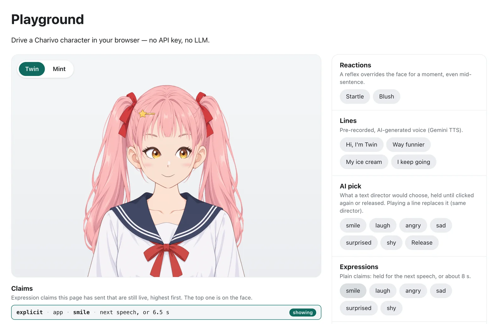

**Charivo** is an open-source TypeScript framework for AI characters that talk, react, and look at you: a Live2D or [Iki](/projects/iki/) model on a canvas, a language model behind it, and a voice going in and out. Each of those is its own `@charivo/*` package on npm behind an interface, so moving a character from OpenAI to Gemini, or from typed chat to live voice, means swapping a client, not rewriting the app. It's the character's embodiment, not an agent framework: planning, long-term memory, and deciding when to speak stay in your app or agent runtime.

## Two ways to hold a conversation

- **Cascade.** Text goes to an LLM, the reply goes to TTS, and the TTS manager analyzes the audio to drive lip sync. A new message cancels the turn still in flight, and `interrupt()` stops a reply mid-sentence.
- **Realtime.** A realtime manager replaces the LLM + TTS pair with one speech-to-speech session: OpenAI Realtime over WebRTC or Gemini Live over WebSocket. Your server route only starts the session and hands out a short-lived credential. After that, the browser streams microphone audio straight to the provider and plays the voice back itself.

OpenAI and Gemini both cover every modality: chat, TTS, STT, and realtime. Chat has a third provider, a local OpenClaw agent. Speech-to-text also comes in streaming form, so a transcript fills in while you're still talking.

## Keys belong on the server

Every modality splits into a stateful manager and interchangeable clients. The `/remote` clients call an API route in your own app, where `@charivo/server` holds the provider key, and that's the path meant for production. There are also browser-direct clients so a demo runs without a server, but they ship the key to the browser and are documented as dev-only. The server-side providers refuse to run in a browser unless you pass `dangerouslyAllowBrowser: true`.

## The LLM picks the expression

`@charivo/avatar` turns the loaded model's own expressions and motions into tools: `setExpression`, `playMotion`, and `lookAt`. The first two take enums built from that model's catalog, so the LLM can't call for an expression the model doesn't have; `lookAt` takes a point to look at. The same tools plug into typed chat and realtime voice alike, so a reply can change the character's expression and pose, not just move its mouth.

## Live2D or Iki

The renderer is a package too. `@charivo/render-live2d` plays Cubism models, and [`@charivo/render-iki`](https://www.npmjs.com/package/@charivo/render-iki) plays `.iki` models from [Iki](/projects/iki/), my open 2D rig engine whose characters an AI agent can draw and rig. Lip sync, gaze, and the avatar tools work the same on either.

Every package is MIT except `@charivo/render-live2d`, which bundles the Cubism SDK for Web. Publishing a product built on it needs Live2D's publication license, from which small developers are exempt in some cases; the Iki renderer needs no license beyond MIT.

## Where it runs

The quickest look is the [playground](https://zeikar.dev/charivo/playground/), which needs no API key and calls no LLM. Iki's Twin and Mint react to buttons with expressions, motions, and glances, and speak pre-recorded, lip-synced lines voiced with Gemini TTS; press Startle mid-line and the face reacts while the voice keeps going. A readout lists the expression claims in play and which one wins.



The other two demos talk back. The [web app](https://charivo.vercel.app/) lets you switch every provider from a settings menu and talk to Live2D or Iki characters, including Iki's [Twin](https://charivo.vercel.app/?character=twin) and full-body [Mint](https://charivo.vercel.app/?character=mint). The [Companion](https://charivo-companion.vercel.app/) is voice-first and remembers you across sessions in the same browser. The docs live at [zeikar.dev/charivo](https://zeikar.dev/charivo/), and a typed-chat character starts from:

```
pnpm add @charivo/core @charivo/llm @charivo/tts @charivo/render @charivo/render-live2d
```

For an Iki model, swap `@charivo/render-live2d` for `@charivo/render-iki`.

[LiveClaw](/projects/liveclaw/) is an Electron desktop app built on Charivo that gives a local OpenClaw agent a Live2D face and a voice.
