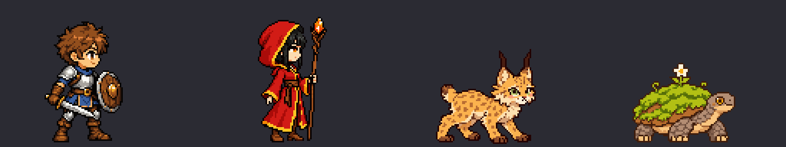

dotomata (*dot + automata*) takes a character from a written description, or from a card illustration of it, to a game-ready pixel sprite: idle, attack, hit and down animations (plus a guard for anyone with a shield) on one transparent sheet, a white mask of the same layout for hit flashes, and a motion JSON with every frame's position, timing and strike frame. Nothing in the output is tied to an engine. In Claude Code, `/dotomata:sprite knight` runs the whole pipeline and stops twice for a person; without Claude Code, the same steps are plain CLI commands (`uvx dotomata generate knight` through `build` and `verify`), with the parts mask and the checkpoint calls done by hand. It needs [uv](https://docs.astral.sh/uv/) and, for the generate steps only, a logged-in Codex CLI with image generation. It is on PyPI under MIT; the example art is from a game of my own and isn't covered by that license.

## The model draws one pose, code does the rest

The image model is asked for exactly one thing: the character standing still on a flat magenta background. Everything after that is code. A shared rig splits the figure into parts (head, torso, both arms, legs, and weapon, shield, staff, bow or helmet layers hung on a joint), and motion templates move those parts by whole pixels, swap in an alternative drawing (a raised arm, wings up) or replace the whole figure (the fallen pose). There is no rotation and no scaling, since either one breaks pixel art, so every frame stays on the same grid and palette as the pose the model drew.

That makes animation data rather than drawings. The humanoid, beast, slime, flyer and silhouette rigs and their templates live in the config, so a new character reuses every motion and needs no new animation code: one generated pose, a parts mask and joints, and a few small hand-drawn extras such as the fallen pose. A difference only one character needs goes into that unit's `overrides`, never into the shared template.

## Image models ignore the size you ask for

Asked for an 80-pixel humanoid, the model came back 116 to 166 pixels tall: it draws on its own pixel grid whatever the prompt says. So each sprite takes two passes. A design pass generates a batch and picks the design closest to the description, size aside. A size pass then shrinks that pick to the target height in code and sends the small version back as a block-exact reference, asking the model only to clean up the face, outline and metal details on that grid. The shrinking had its own trap: a plain majority vote per cell erased one-pixel outlines whenever two cells merged, so a dark outline colour wins a cell once it covers enough of it.

Reading a generated image back into pixels is its own step. `convert` keys out the background (the model's magenta is never exactly `#FF00FF`, and pink fringe pixels get peeled off), then looks for the one square cell size and offset whose grid lines catch the most colour edges beyond what random lines would. The cell is kept square because, measured per axis, the two sizes drifted apart. Colours go through seeded k-means and are merged down to a palette cap.

## A sheet ships only if it passes

`build` writes nothing until every check passes. The figure is within tolerance of its target height, measured without the weapon it holds; its feet sit on the foot row in every standing frame (a flyer hovers at its air point instead); no pixel is semi-transparent; the palette is within its cap; every cell's one-pixel border is empty, which also catches a drawing cut off at the edge; and every action has its exact frame count with the strike landing within the wind-up limit. Hand fixes never touch the converted grid. They are a list of cell edits with a category and a reason, and the build report counts how many cells were fixed and how many were drawn new.

`verify` rebuilds every sprite, card art and background from its committed sources and compares the result with what's on disk. Outputs carry no dates, paths or tool versions, and Python, Pillow and NumPy are pinned exactly, so the same sources give the same pixels. PNGs are compared by decoded pixels rather than bytes, because Pillow's zlib-ng compresses the same image differently on Apple silicon and on Linux x86.

## Every picture comes from its own run

Each `codex exec` run starts in a temp folder outside the project, so no project instructions reach the prompt, and is told to call the image tool exactly once and save nothing. The one-call and no-saving rules both came from failures. Told to save its picture, one run of a parallel batch couldn't find its own file and copied the picture of a run beside it; left free, a run would sometimes call the tool again to hand its picture over, and that second call drew something else from a throwaway prompt. So dotomata takes the image out of the run's own Codex session record, the first completed generation that decodes as a PNG, and a file the model left lying around is never read.

The same record keeps the budget honest. Codex's `--json` stream has no image events, so generations are counted from the session record, where one call can appear in two shapes, and a run that fails or leaves no record still counts as one. Each character has a generation cap that stops a batch before it starts. Every candidate's prompt, reference, model and sha256 go into the unit's generation record, and an image whose sha256 is already in any generation record is refused.

## Two calls stay with a person

The pipeline runs in three segments with a checkpoint after each. Of the four decisions, the person makes two: adopting a candidate and approving the final animation. The skill makes the design pick and signs off the hand fixes itself, and shows them alongside the next decision, which halves how often a character waits on someone. Every decision is written to `checkpoints.json` with the reason. The CLI won't record a checkpoint until the previous one is approved, and redoing an earlier checkpoint voids the later ones. The `sprite-artist` agent that does each segment's work never asks the person anything and never records a checkpoint, so a step can't approve itself.

## Card art first, sprite second

The same generation runner also paints card art (a 2:3 portrait, cropped to a square bust) and 16:9 backgrounds. A character with adopted card art draws its sprite from that illustration, which is how the knight and the lynx above kept their faces from card art to sprite.
