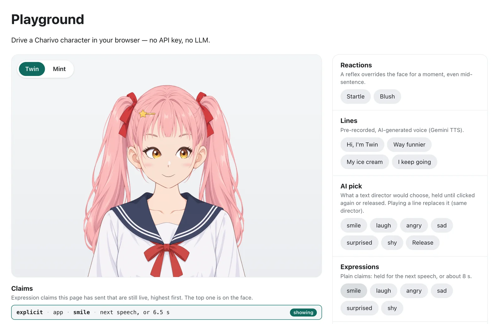

**Iki** (息 breath · 生き life · 粋 chic) is a 2D puppet rig engine for the web, and an AI agent can build its characters: describe one, and an image model draws the parts and the auto-rigger turns them into a rigged, animated model. Hand it one finished picture instead, and it cuts the parts out of that. Art already in layers needs no AI at all: the editor rigs it in the browser. Live2D Cubism is the industry standard and [Inochi2D](https://inochi2d.com/) the established open alternative. I made Iki because I couldn't find a permissive license, a plain-text format, and a rig an agent can build in one place.

## An agent draws and rigs the character

- **What goes in:** one of three things. A text description, from which the plugin generates each part. One finished, front-facing picture, which the plugin cuts into layers in place, painting in what each layer hides, so at rest the model is the picture itself. Or your own transparent PNG layers named by role, or a plain PSD of the same layers, in the editor. `face`, `eye_L`, `eye_R` and `mouth` are required; irises, brows, lashes, nose, blush, hair, and torso are optional.
- **What comes out:** a validated `.iki` model that blinks, gazes, lip-syncs, turns, nods and tilts its head, moves its brows, and breathes, with hair swaying on physics. It also gets nod, shake and tilt motions and up to six expressions that a host plays by name: smile, laugh and surprised on any model, angry and sad when it has brows, shy when it has blush. On a turn the nose leads, the features slide across the face, and the back hair trails behind, so it reads as a head rotating rather than a cutout sliding.
- **How an agent drives it:** the `@ikijs/mcp` server exposes `auto_rig_from_layers`, plus `compose_layers_from_parts` to place generated part images on a shared canvas and `measure_layers`, a geometry report that catches an iris the wrong size for its eye or a cropped edge before it costs another round of image generation. `measure_turn_reference` measures how far a head turns between a front and a turned reference image, so the rig's turn can be fitted to it. For a finished picture, `view_illustration_grid` shows it under a coordinate grid so the agent can read landmarks off it (the eyes, the brows, the bangs), and `cut_layers_from_illustration` cuts along them and reports numeric checks the agent fixes against.

The plugin, for Claude Code and Codex, bundles the server with three skills: a single pass from a text description to a finished `.iki`, a generator/critic loop in which an artist agent draws and re-rigs while a critic agent scores the render against a reference image until it's worth shipping, and the import that cuts one finished picture. Drawing the parts needs an image generator; the prompts were tuned against Codex CLI's built-in image generation.

```
/plugin marketplace add zeikar/iki
/plugin install iki@iki
```

## What a rig is made of

That only works because the model is small and readable. A `.iki` file is one JSON document, textures included, and it's made of:

- **Parameters.** Named, ranged values like `ParamAngleX` or `ParamEyeLOpen`. A standard set of ids lets any host drive any model without wiring it up per model.
- **Parts.** Quads or triangle meshes cut from a texture atlas, moved, rotated, scaled, and faded by parameters through linear bindings.
- **Deformers.** Pivoted matrix deformers in a parent hierarchy, plus warp grids with keyforms, including 2D grids that blend a head turn with a nod.
- **Clipping masks.** Stencil-based, so an iris clipped to its eye white never spills out at extreme gaze.
- **Physics.** Spring-mass-damper rigs and multi-segment gravity chains for hair.

The validator fails fast and names the exact path, e.g. `parts[3].mesh.indices[12] 40 is out of range`, so an agent can check its own output. The WebGL2 runtime depends only on the format and knows nothing about its host, which sets parameters from lip-sync, gaze, and expressions while the engine's motion driver handles idle blinking, breathing, and physics.

## Using it

The format, engine, a headless editing core, and the MCP server are on npm under `@ikijs`. The [landing page](https://zeikar.dev/iki/) plays the generated hero live, its head and eyes following the mouse. The [playground](https://zeikar.dev/iki/playground/) drives it with the sliders, expressions, and motions a host would use, switches to the same character cut from one picture or to full-body models, and opens any `.iki` you load. The [editor](https://zeikar.dev/iki/editor/) auto-rigs a set of named layers (or [its sample set](https://zeikar.dev/iki/editor/?sample)) in a couple of seconds, authors parts, deformers, and physics rigs, and exports a validated `.iki`.

The runtime goes wherever WebGL2 does: a web page, an Electron window, an OBS browser source. [Charivo](/projects/charivo/) renders `.iki` models through [`@charivo/render-iki`](https://www.npmjs.com/package/@charivo/render-iki), and its [playground](https://zeikar.dev/charivo/playground/) runs the hero character, Twin, and a full-body one, Mint, with no API key: they react to buttons with expressions and glances and speak pre-recorded lines with lip-sync. Its [live demo](https://charivo.vercel.app/?character=twin) lets you talk to them by chat or voice.



## What it isn't, yet

Iki is 0.x. It rigs and plays characters, but it isn't a VTuber app: there's no webcam face tracking, so your code or a host like Charivo drives the character. Characters are front views that turn about 30° either way, not full 3D turns. It can't load Live2D models, there's no native or Unity runtime, and until 1.0 the `.iki` format can still change. For production-grade rigging today, use Cubism.
